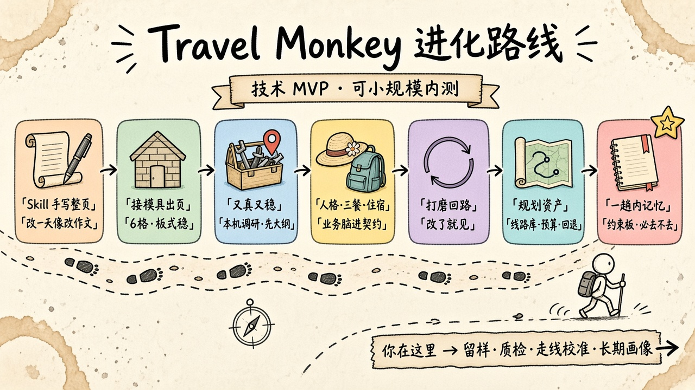
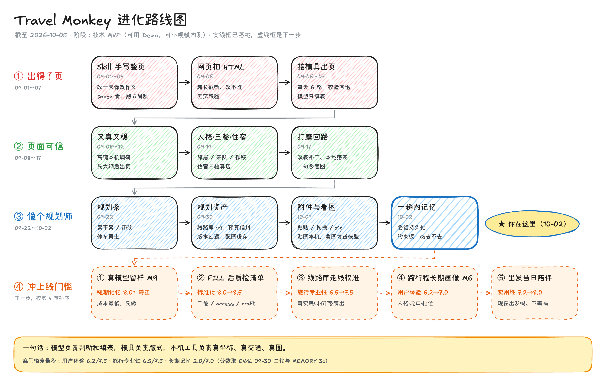

# Travel Monkey：改动沉淀与能力地图

本文整理 Travel Monkey（仓库目录 `travel-monkey-agent`）从「手写 HTML 攻略」走到「模具出页 + 本机工具」期间的改动，以及这些能力分别服务哪一类产品目标。评测尺子仍以 [EVAL.md](./EVAL.md) 为准；本文不另打分。

读法：先看进化路线，再看分层（Prompt / Skill / 脚本工具 / 第三方），再看第 3、4 节：每项能力推动 EVAL 哪一维、是不是资产，以及据此怎么排优先级。第 7 节是规划专家对本文和产品的评审。**个例店名、某一天的改法不写进通用 Prompt**，写进本机规则或线路库。

---

## 1. 从哪条路走过来

工程上已经走对了：从「改作文」变成「改表格」。规划条（累不累 / 雨砍 / 停车再走）已进每天；还没到能当带队/适老/徒步依据的线路库。

### 1.1 进化路线图（截至 2026-10-05）

同一份路线，两种画法：

- **Banana 风格**：适合汇报、分享，一眼看懂走到了哪。
- **Excalidraw 草图**：信息更全，带日期、阶段和下一步对应的分数；可编辑。

两张图内容一致，改路线时两张一起改。

**Banana 风格（手绘插画）**

**Excalidraw 草图**（源文件 [`travel-monkey-roadmap.excalidraw`](./travel-monkey-roadmap.excalidraw)，拖进 [excalidraw.com](https://excalidraw.com) 即可编辑）

**怎么对号入座**：图里的每一站都对应本文某一节。

| 图上的阶段 | 站 | 本文对应 |
|---|---|---|
| ① 出得了页（09-01～07） | Skill 手写整页 → 网页扣 HTML → 接模具出页 | 1.2 时间线前四行；2.2、2.3 的模具与校验 |
| ② 页面可信（09-08～17） | 又真又稳 → 人格·三餐·住宿 → 打磨回路 | 1.2 时间线 09-08～09-17；3.1 标准化、3.4 稳定性 |
| ③ 像个规划师（09-22～10-02） | 规划条 → 规划资产 → 附件与看图 → 一趟内记忆（**你在这里**） | 1.2 时间线 09-22～10-02；8.1 第 1～13 项；3.2 旅行专业性、3.6 上下文与记忆 |
| ④ 冲上线门槛（下一步） | 真模型留样 M9 → FILL 后质检清单 → 线路库走线校准 → 跨行程长期画像 M6 → 出发当日陪伴 | 第 4 节差距表与第 5 节第 1～4 条；当日陪伴见 3.3、7.3 |

所处阶段沿用 EVAL 最近快照：**技术 MVP（可用 Demo，可小规模内测）**。阶段 ④ 的顺序就是第 4 节按「离门槛差多少、是不是资产」排出来的顺序，图上标的分数也取自第 4 节。

### 1.2 时间线

| 大约时候 | 站 | 做法 | 学到什么 |
|---|---|---|---|
| 2026-09-01～05 | Skill 手写整页 | Cursor 里跑 `travel-plan-viz`：规划蜀道 6～7 日，改日期、加点、换图、上传公网 | 内容可以很满；改一天像改作文，token 贵、版式易乱 |
| 2026-09-05 | 定 6 格 | 「每天线路 1 + 景 3 + 住 1 + 餐 1」写进 Skill 契约 | 阅读结构必须先于美 |
| 2026-09-06 | 网页扣 HTML | 网页 Agent 从模型回复里抠 `<html>` | 超长截断、改不准、无法校验 |
| 2026-09-06～07 | 接模具出页 | `renderTrip` + `validateAll` + 种子 JSON；Skill 原文不每轮塞进提示 | 板式稳、可分享；规划仍靠临场 |
| 2026-09-08～12 | 又真又稳 | 契约蒸馏进 PLAN/FILL；高德/搜索本机调研；本地皮；先大纲后出页 | 模型填表，本机落地；密钥不能填网页地址 |
| 2026-09-14 | 人格·三餐·住宿 | 旅居/带队/探秘；强制 `dining` 早午晚；片区经济/中档/高端各一家 | 业务脑开始进契约，不只进渲染 |
| 2026-09-17 | 打磨回路 | 改表补丁、本地落表、一句多意图（改点+补图）；配图高德优先 | 用户不会一次规划完；页面必须跟着改 |
| 2026-09-22 | 规划条 | 日级 `craft`：累不累 / 雨砍 / 停车再走；本机缺则补，模具画在 6 格上方 | 没有这三句，页面只是观光日 |
| 2026-09-30 | 规划资产＋改了就见 | 住宿适老/连住/集合点、预算信封、行程版本回退、线路库 v1→v4、配图落盘；同日连修改天必见、意图路由、补丁健壮性三轮 | 「说了就改、改了就见」是可用性前提，之前的分在这条链断裂时都是虚的 |
| 2026-10-01 | 附件与看图 | 粘贴/拖拽图片与文本、zip 本机拆包；`look` 模式真送模型看图，贴图走本机不花钱 | 分流比能力本身重要：能本机做的不烧 token |
| 2026-10-02 | 闭环＋记忆 | 依赖全部收进仓库、改名；会话存 IndexedDB 可新建/切换/删除；约束板（硬约束＋必去/不去）每轮注入；出大纲带用户原话；窗口外本机摘要；认改口 | 记忆先做「一趟内不忘」，结构化事实比塞原文可靠 |
| 现在之后 | 还没走到 | 真模型留样（M9）、跨行程长期画像（M6）、FILL 后质检清单、线路走线校准、出发当日陪伴 | 见第 5 节与 [MEMORY.md](./MEMORY.md) |

一句话：**模型负责判断和填表，模具负责版式，本机工具负责真坐标/真交通/真图。** 不要让模型写 CSS，也不要把 skill 原文每轮塞进上下文。

---

## 2. 分层盘点

### 2.1 Prompt（通用契约，不是个例说明书）

位置：`server/skill-prompt.mjs`。五种模式，**互斥**，短、可校验。

| 模式 | 干什么 | 刻意不干什么 |
|---|---|---|
| PLAN | 短大纲：人格、每日 6 段、三餐店名、住宿片区三档、最多 3 条待确认（每条必须带「答案：A/B/C/D」） | 不写 JSON、不写 HTML |
| FILL | 只输出一份 `trip` JSON | 不编 photo URL、不写 `themeCss`、不重排已确认大纲 |
| TALK | 对照摘要回答好不好走、吃什么、远不远、累不累、下雨砍什么、车停哪 | 不假装已改、不讲配图流水线、不说「两条线」；追问必须带「答案：」行 |
| EDIT | 只输出补丁 JSON（`changes` / `replaceDays`），用户说了新约束或改口时另带 `facts`（可标 `drop`） | 不吐完整 trip；新增≠改名；配图交给本机；不排「不去」的点；必须问时 reply 带「答案：」行 |
| LOOK | 看用户贴的图，分清「看得见的」和「推测的」并写明把握 | 不改页面；认不出不硬凑景点名 |

PLAN / TALK 回复末尾可带一行「记下：k=v；作废=k:v」，本机解析进约束板后从显示里摘掉（`MEMO_RULE`）。每种模式发出去的消息都在最前面带「本趟硬约束」块。

原则：

- Prompt 只写**规则**（新增写进空格或午休/茶歇；三格都是实点则只问替换哪一格）。
- 不要写店名对照或某一天的改法；个例由本机 `applyAdds` / 名称匹配处理。
- Skill 原文（`SKILL.md`、`page-contract.md`）启动时只做状态展示，**不每轮注入**，省 token。

### 2.2 Skills

| Skill | 角色 | 和网页 Agent 的关系 |
|---|---|---|
| `travel-plan-viz` | Cursor 侧完整规划+出页流程；6 格契约、调研指南、校验 | 网页端蒸馏其契约，**不执行**其「每次用 frontend-design 重画 HTML」 |
| `changting-eval` | 复评步骤 | 尺子只在 EVAL.md；Skill 不另定标准 |
| 模具 `page-contract.md` | 每天 6 格、字段、禁手拼预订链 | 渲染与校验的硬约束 |
| `research-guide.md` | 调研清单；可选官方 MCP | 网页端用本机 HTTP 实现其中能落地的部分 |

模具和 Skill 是两层：Skill 管「怎么规划」，模具管「怎么出页」。第 4 步换皮只换本地主题包，校验失败回退陶土宣纸。

### 2.3 脚本与本机工具（真正省 token 的一层）

| 模块 | 作用 |
|---|---|
| `src/lib/trip.ts` | 行程摘要 `digestTrip`；意图：改表/同步/新增/配图/规划条；本地解析 1–6 点、改格、改餐、减负/雨砍/停车、新增点；`applyChanges` / `applyReplaceDays` / `applyAdds` |
| `src/lib/target.ts` | 点名某一天/某一格：Token 对上格子再改内容或补图，不写个案；括号里的通称当别名（「人头上（人头山）顶」认「人头山」） |
| `src/App.tsx` | PLAN→确认出页→FILL；改表与配图可同一句执行；每次成功出页留版，工具栏「回到上一版」；会话自动保存与恢复、左栏会话条与约束板 |
| `src/lib/context.ts` | 每轮发给模型的消息怎么拼（纯函数）：约束块＋窗口外摘要（约 300 字）＋行程摘要＋最近几条；出大纲/填表带用户原话（约 600 字） |
| `src/lib/memory.ts` | 约束板：硬约束九类＋必去/不去，本机抽取、认改口撤销、解析模型「记下：」行与 `facts`；本机查「不去」的点是否又被排进大纲或页面 |
| `src/lib/session.ts` | 会话存 IndexedDB（全量表＋列表表），打不开时退化为只在内存 |
| `src/lib/zip.ts` | 不引第三方库的 zip 读取（中央目录＋浏览器内置解压） |
| `server/viz.mjs` | 补齐三餐、人格；住宿栏只用真店名+位置（调研三档优先），景点名不当片区、不造「经济参考」凑图；适老/连住/集合点按人格进 tips；`trip.budget` 预算信封 |
| `server/photos.mjs` | 配图管线：点评→高德→百度→维基；只换点名的格子；检索词景点名在前；换失败保留原图；名点图落盘缓存（`server/.cache-photo.json`，跨重启复用） |
| `server/research.mjs` | 规划前调研一次：地理编码、POI（含地址）、天气、三档酒店线索、公开搜索摘要；酒店不过滤省名（避免「甘肃」误杀甘南店）；线路库 v4 三层（L1 高德 POI 活数据／L2 8 条模式非实测标注／L3 2 条薄数据实测线带来源更新置信）进摘要供 FILL 强引用 |
| `server/transport.mjs` | 邻点步行/公交耗时；30km 以上城际走驾车（`intercity`）；按人格转公交阈值（旅居 20min/带队 30min/探秘 90min）；`actionLink` 只用官方 `uri.amap.com`（GCJ-02→WGS-84） |
| `server/craft.mjs` | 日级规划条：负荷 / 雨砍 / 停车再走；FILL 缺则按人格+点名补齐 |
| `server/themes.mjs` | 本地皮，换皮不走模型 |
| `server/chat-proxy.mjs` | 按模式挂系统提示（plan/fill/talk/edit/look）；密钥与服务商错配提示；带图这轮把图挂到最后一条用户消息上，上游嫌弃图片时翻成「换个认图的模型」 |
| `server/images.mjs` | 把本机图读成 base64 发给模型：只认 `travel-assets/` 下的文件（越界路径一律拦）、单图 5MB、一次最多 4 张；OpenAI 用 `image_url`，Anthropic 用 `image.source.base64`，外链原样透传 |
| `server/uploads.mjs` | 收粘贴/拖入的图：存成 `travel-assets/uploads/<内容hash>.<ext>`，只认 jpg/png/webp/gif/avif，单张 8MB，文件名由哈希定（不吃用户传的路径） |
| `src/lib/attach.ts` | 附件读取与分流：`wantsVision` 判这一轮是贴图（本机、不花钱）还是看图（送模型、烧 token） |
| 模具 `gen-shudao-html.js` + `validate` | 固定 6 格栅格、清单、地图 |
| 导出 | 单文件 H5、长图、系统分享 |

能本地落表（「请同步」且上文已有 1–6 点；「第 N 天第 M 格改成…」；「某天新增某点」）就**不打模型**。

### 2.4 第三方能力：现状不是 MCP，是本机 HTTP

网页 Agent **当前没有**把高德/小红书/百度/维基接成 Cursor MCP。它们是 Node 里直连的开放接口或公开页。Skill 文档里的「官方 MCP 优先」是 Cursor 侧增强项，网页端用同一套 `trip` 字段降级实现。

| 来源 | 网页端怎么用 | 有 Key？ | 不能做什么 |
|---|---|---|---|
| **高德 Web 服务** | 地理编码、POI、店图、天气、步行/公交、官方导航 URI | 可选 `ct.amap` | 不代叫车、不写死 deeplink |
| **Tavily / Serper** | 航班/酒店/时令公开页摘要；部分配图检索 | 可选 | 不代订、不保证实时价 |
| **百度图片** | 高德店名对不上时的第二层 | 无（公开页） | 易脏，必须店名/地点打分 |
| **维基 / Commons** | 百度对不上时的第三层，名点较稳 | 无 | 冷门点易配错；宁空 |
| **大众点评店页** | 有搜索 Key 时的第一层 | 需搜索 Key | 只取 `dianping.com/shop` 公开图；无官方点评接口；不爬商户后台 |
| **飞猪** | 契约写「不能代订、不手拼预订链」 | 未接官方预订 | 没有 MCP/开放下单就不装可订 |
| **OSM / Leaflet** | 行程地图底图 | 无 | 坐标必须 WGS-84 |
| Cursor 里 Notion / Figma 等 MCP | 开发工作流 | 与旅行产品无关 | 不要当成行程数据源 |

若以后要「更像官方旅行 Agent」，优先接 **高德官方 MCP**（坐标、路况、天气、导航），其次才是飞猪类预订 MCP。点评/图搜没有稳定官方 MCP 时，维持「店名对上才用图」，不要做爬虫。

---

## 3. 能力怎么归类：推动 EVAL 哪一维 × 是否成为资产

每项能力只回答两个互不相干的问题。

**问题一：它推动 EVAL 哪一个打分维度？** EVAL 第 1 节共有 6 个打分维度，名字照抄，不用简称：

| EVAL 编号 | 打分维度 | 看什么 |
|---|---|---|
| 1.1 | 标准化 | 契约管不管得住模型：6 格、分模式、禁写 HTML、校验回退、必填字段 |
| 1.2 | 旅行专业性 | 像不像资深规划：线路库、必看/可砍、适老/徒步/集合点、负荷与雨备 |
| 1.3 | 实用性 | 能不能走完「规划 → 出页 → 小改 → 带走」 |
| 1.4 | 稳定性 | 页面稳＋内容稳。**可信**（宁空不配错、没改成不说改了、实时与参考分开）记在这里 |
| 1.5 | 用户体验 | 像不像顾问：提问只回答、改了点名格子、说人话、不挡目标用户 |
| 1.6 | 上下文与记忆 | 上下文管理、短期记忆、长期记忆、多轮会话（细则在 [MEMORY.md](./MEMORY.md)） |

EVAL 的 1.7 合理性、1.8 完善程度是横切判断，不是维度，不用来给能力归类。

写法：只写真能推动分数、对得上该维锚点的 1～2 维；对不上任何锚点的就不写，宁少勿凑。EVAL 里的四项业务（路径/景点/三餐/住宿）和三类人格分是这几维的细分视角，需要时写在「对上哪条锚点」里。

**问题二：它是资产，还是一次性的？**

- **资产**：会随使用变多变准、能被别的入口复用的数据或规则——线路库、入住/人格规则、配图与坐标缓存、页面契约、用户画像、回归测试集。
- **一次性**：修好或接好就结束，不会再增值——bug 修复、交互通道（附件、导出）、单次接线。不是说它不重要，而是它不积累。

### 3.1 标准化（EVAL 1.1）

| 能力 | 对上哪条锚点 | 资产 / 一次性 | 状态 |
|---|---|---|---|
| 6 格模具＋校验失败回退陶土 | 每天固定 6 格；`validateAll` 回退 | 资产（契约） | 已固化 |
| PLAN/FILL/TALK/EDIT/LOOK 五模式互斥、短提示 | 分模式；模型禁写 HTML/CSS | 资产（契约） | 已做 |
| 强制三餐 `dining`、住宿三档、`day.craft` 进 FILL 契约 | 模具能画的字段 FILL 强制 | 资产（契约） | 已做 |
| 个例不进 Prompt，进本机规则或线路库 | — （纪律，保护以上几条不被个案冲垮） | 资产（规则） | 执行中 |
| FILL 后质检清单 | 质检清单 | 资产（规则） | **未做**（8.0→8.5） |

### 3.2 旅行专业性（EVAL 1.2）

| 能力 | 对上哪条锚点 | 资产 / 一次性 | 状态 |
|---|---|---|---|
| 线路库 v4 三层（L1 高德 POI／L2 8 模式／L3 实测线），FILL 强引用 | 经典线路库；代表性可校验；必看/可砍 | 资产（库） | 已落；走线校准未做（旅行专业性主缺口） |
| 人格规则＋住宿适老/连住/集合点（`stayFitTip`） | 老人节奏；住宿适老/连住/集合点判断 | 资产（规则） | 已做 |
| `day.craft`：负荷 / 雨砍 / 停车再走 | 徒步难度与补给；老人节奏 | 资产（规则） | 已做 |
| 预算信封 `trip.budget` | 住宿「住得对」的一部分（业务：住宿） | 资产（规则） | 已做 |
| 高德交通、30km 城际驾车、按人格转公交阈值 | 业务：路径「算得清」 | 资产（规则）；坐标本身未入库 | 有 Key 时可用 |
| 闭馆/演出时刻、多人汇合、风险退出 | 价格与时刻有核验 | 资产（规则/库） | **未做** |

### 3.3 实用性（EVAL 1.3）

| 能力 | 对上哪条锚点 | 资产 / 一次性 | 状态 |
|---|---|---|---|
| 先大纲后出页＋待确认点选 | 先大纲后出页 | 资产（流程契约） | 已做 |
| 本地落表（请同步 / 第 N 格 / 新增点），0 token | 改一天不重规划 | 资产（句式规则，随句式增多） | 已做 |
| 一句多意图：先改表再配图；改名后本机补图补交通 | 改一天不重规划 | 一次性 | 已做 |
| H5 / 长图 / 分享 | H5 / 长图 / 分享可用 | 一次性 | 已做 |
| 无 Key 诚实降级 | 无 Key 时仍诚实降级 | 一次性 | 已做 |
| 行程版本回退（近 10 版，随会话存） | 改一天不重规划（敢改） | 一次性 | 已做 |
| 附件 / zip / 看图分流 | 「带进来」这半程；贴图不烧 token | 一次性 | 已做 |
| 出发当日陪伴 | 「带走」之后还能用 | — | **未做**（7.2→8.0） |

### 3.4 稳定性（EVAL 1.4，含可信）

| 能力 | 对上哪条锚点 | 资产 / 一次性 | 状态 |
|---|---|---|---|
| 配图宁空不配错、只换点名格、失败保原图 | 配图宁空不配错 | 资产（规则） | 已做 |
| 收据验货：新名不在页面就不说「已写入」；没改成不转述「已改好」 | 内容稳（可信） | 资产（规则） | 已做 |
| `dataSources`、实时 vs 参考分开、不代订 | 内容稳（可信） | 资产（契约） | 已做 |
| 配图缓存落盘 `.cache-photo.json` | 内容稳；调研不每轮重跑 | 资产（缓存） | 已做 |
| golden 回归（121 条） | 有可运行证据，改动不回退 | 资产（回归集） | 已做 |
| `resolveTargets` 对格、`inferAddsFromText` 新增≠改名、组合店名切分、意图路由修复 | talk / edit 误判（低分锚点的反面） | 资产（规则） | 已做 |
| 补丁容错（平铺补丁照收、本机按原话兜底改） | 编辑打补丁 | 一次性修复 | 已做 |
| 调研只做一次；密钥拒页面 URL、错配前置提示 | 调研不每轮重跑；密钥拒绝页面 URL | 一次性 | 已做 |

### 3.5 用户体验（EVAL 1.5）

| 能力 | 对上哪条锚点 | 资产 / 一次性 | 状态 |
|---|---|---|---|
| 问答契约「答案：A/B＋按你建议/先跳过＋自己写」，待确认不自动提交 | 待确认不自动提交 | 资产（契约） | 已做 |
| TALK 禁「两条线、同步不了」；出页/报错说人话 | 提问只回答；不套话循环 | 资产（规则） | 已做 |
| 改表回执点名格子、读新安排 | 改行程只打补丁并点名格子；改完读新安排 | 一次性 | 已做 |
| 人格检测，看不出先问 | 老人大字少术语（按人格说话的前提） | 资产（规则） | 已做 |
| 本地换皮 | 设计感不靠模型 | 一次性 | 已做 |
| 工作台密钥对目标用户下沉 | 低分锚点「开发者工作台」 | — | **未做** |

### 3.6 上下文与记忆（EVAL 1.6）

| 能力 | 对上哪条锚点（MEMORY 2.x） | 资产 / 一次性 | 状态 |
|---|---|---|---|
| `trip` JSON 唯一事实源＋`digestTrip` 按天裁 | 2.1 结构化事实、每轮短摘要 | 资产（契约） | 已做 |
| 约束板（硬约束＋必去/不去、认改口、撞否决自动打回） | 2.2 硬约束结构化、每轮都带 | 资产（规则） | 已做（10-02） |
| 出大纲带用户原话、窗口外本机摘要 | 2.2 不因大纲漏写而丢；窗口外有摘要 | 一次性 | 已做（10-02） |
| 会话持久化＋多会话 | 2.4 会话 ID、刷新恢复、可切换 | 一次性 | 已做（10-02） |
| 多轮回归脚本（`context.ts`＋golden 场景） | 2.2 / 2.4 的证据 | 资产（回归集） | 已做（10-02） |
| 跨行程长期画像 | 2.3 用户确认后写入、可看可删 | 资产（画像） | **未做**（M6） |

### 3.7 资产清单

上面标「资产」的汇总在这里，方便看哪些在积累、哪些还没入库：

| 资产 | 形态 | 状态 |
|---|---|---|
| 6 格页面契约＋五模式提示 | 模具、`server/skill-prompt.mjs` | ✓ 勿为个案拆格 |
| 线路库 v4 | `server/routes.json` | ✓ 走线校准未做 |
| 人格 / 入住 / craft / 配图 / 可信规则 | `server/viz.mjs`、`craft.mjs`、`photos.mjs`、`src/lib/trip.ts` | ✓ |
| 配图缓存 | `server/.cache-photo.json` | ✓ |
| POI 真名＋WGS-84 | 仅当次调研 | △ 未入库 |
| 约束板规则 | `src/lib/memory.ts` | ✓ 单用户本机 |
| golden 回归集 | `scripts/golden-test.mjs`（121 条） | ✓ |
| EVAL / MEMORY 尺子 | `docs/` | ✓ |
| 用户长期画像 | — | ○ M6 |

继续加皮或加爬虫，边际收益低：它们大多是「一次性」，且推不动当前差距最大的旅行专业性和用户体验。

---

## 4. 用两问排优先级

规则：**离门槛差得多的维度优先；同等差距下，资产优先于一次性；能同时推两维的优先。** 分数取 EVAL 最近快照（09-30 二轮）与 MEMORY 3c。

| 维度 | 当前 | 门槛 | 差 | 下一项该做的（资产 / 一次性） |
|---|---|---|---|---|
| 用户体验 | 6.2 | 7.5 | 1.3 | 跨行程长期画像 M6（资产，同推记忆）；工作台密钥下沉（一次性） |
| 旅行专业性 | 6.5 | 7.5 | 1.0 | 线路库走线校准：真实耗时、闭馆、演出时刻（资产） |
| 实用性 | 7.2 | 8.0 | 0.8 | 出发当日陪伴（一次性为主） |
| 稳定性 | 7.5 | 8.0 | 0.5 | FILL 后质检清单（资产，同推标准化） |
| 上下文与记忆·长期记忆 | 2.0 | 7.0 | 5.0 | 同用户体验那行的 M6 |
| 上下文与记忆·短期记忆 | 8.0\* | 8.0 | 待证 | 真模型留样 M9（成本最低，先做） |
| 标准化 | 8.0 | 8.0 | 0 | 已达门槛；质检清单顺带 8.0→8.5 |

读法：长期记忆差距最大，但 M6 依赖 M9 先证明短期记忆真的被模型照做；旅行专业性是 EVAL 一直点名的主缺口，且走线校准是纯资产。所以第 5 节的顺序是 M9 → 质检清单 → 走线校准 → M6。

---

## 5. 下一刀（按第 4 节排序）

原列 1～4（住宿一等公民、线路库、行程版本、配图落盘缓存）已于 09-30 落地，见 §8.1。现在仍成立的下一刀（与 EVAL「还没勾上的锚点」、MEMORY 待办对齐）：

1. **真模型留样（MEMORY M9）**：短期记忆从 8.0\* 转正的前提，成本最低。
2. **FILL 后质检清单**：三餐、access、craft 必填项机器校验。标准化 8.0→8.5。
3. **线路库走线校准**：真实耗时、闭馆日、演出时刻。旅行专业性 6.5→7.5。
4. **跨行程长期画像（MEMORY M6）**：人格、忌口、档位，用户确认才写。用户体验 6.2→7.0。
5. **高德 MCP（可选）**：仅当要实时路况/多方案交通时再接；网页 HTTP 已覆盖地理编码与邻点。不要为「接 MCP」而接。
6. **Prompt 纪律**：通用契约保持短；新规则进 `trip.ts` / photos，不进 `EDIT_SYSTEM` 个例。
7. **规划专家层（第一刀已落地）**：`day.craft` 回答累不累、下雨砍什么、车停哪再走；总预算已由 `trip.budget` 回答。还缺的是闭馆/演出时刻、多人汇合、风险退出、当日陪伴。

---

## 6. 文件索引

| 文档/代码 | 用途 |
|---|---|
| `docs/EVAL.md` | 怎么打分、当前快照 |
| `docs/CAPABILITY.md` | 本文：改动与能力地图 |
| `docs/MEMORY.md` | 上下文、记忆、多轮会话的评测标准、快照与待办（M1～M9） |
| `.cursor/skills/changting-eval/SKILL.md` | 复评步骤 |
| `server/skill-prompt.mjs` | 五模式 Prompt |
| `src/lib/trip.ts` | 意图与本地落表 |
| `src/lib/context.ts` / `memory.ts` / `session.ts` | 每轮消息拼装、约束板、会话存储 |
| `server/craft.mjs` | 日负荷 / 雨砍 / 停车再走 |
| `server/photos.mjs` / `research.mjs` / `transport.mjs` | 图、调研、路 |
| `docs/travel-monkey-roadmap-banana.jpg` | 第 1.1 节进化路线图（Banana 风格） |
| `docs/travel-monkey-roadmap-excalidraw.png` / `.excalidraw` | 第 1.1 节进化路线图（Excalidraw 草图及可编辑源文件） |
| `vendor/mold/` | travel-plan-viz 完整副本：出页、校验、坐标、契约、调研/美学说明、样例、种子 JSON、单测。不再读仓库外的 travel-plan-viz-main |
| `travel-assets/` | 种子配图；用户上传在 `uploads/`（不进版本库） |

---

## 7. 规划专家评审：本文与产品还差什么

评审立场：资深线路规划（带过退休团、导游备课、徒步向导三种活），不是前端评审。对照「专业、超高体验的旅行 Agent」，不是对照「能演示的网页」。

### 7.1 这份文档本身

| 判断 | 说明 |
|---|---|
| **合理** | 分层对（Prompt / Skill / 本机工具 / 第三方）；能力按「推动 EVAL 哪一维 × 是否资产」归类，和评分表同一套说法，能直接按分差排优先级；第三方边界诚实（高德是 HTTP 不是 MCP；不代订） |
| **作为工程地图够用** | 开发者能知道「不要抠 HTML、不要个例进 Prompt、能本地落表就不打模型」 |
| **作为专业产品说明书不够** | 缺「什么样的一天算合格」；缺三类人的质量条；第 5 节几乎全是工程债，规划债只点了住宿和线路库 |

建议：本文继续当能力地图，不要写成 EVAL 第二份打分表。规划质量条补在本节，分数仍只改 EVAL。

### 7.2 已经像专业产品的部分

- **先大纲后出页**：真规划也是先定骨架再填点，不会一上来排版。
- **6 格阅读结构**：带队讲解和老人阅读都吃得下；一天三景封顶对旅居是对的。
- **宁空不配错图**：错图会直接毁掉信任，比空白更伤。
- **不装可订**：没有官方下单却放「去预订」是业余。
- **实时与参考分开**：高德路、搜索价，分得清才像顾问。
- **打磨回路**：真用户一定会改某一天；页不跟着改，前面全白做。

### 7.3 要「超高体验」还缺的规划能力

第一刀（累不累 / 下雨砍什么 / 车停哪再走）已进 `day.craft`，画在 6 格上方。对专业 Agent 下面其余项仍不是锦上添花。

| 缺口 | 旅居 / 带队 / 探秘分别要什么 | 文档/产品现状 |
|---|---|---|
| **日负荷** | 旅居：步行公里与爬升封顶；带队：集合后总时长；探秘：海拔、补给点、撤退点 | **已落地** `craft.load`（轻/中/偏累 + 走路量 + 原因）；公里/爬升/海拔仍是下一刀 |
| **天气与拥挤开关** | 节假日/周末换室内或错峰；暴雨砍露天徒步；暑热把户外提前 | 调研有一次天气摘要，不会改排程 |
| **闭馆 / 演出时刻** | 闭馆日、夜场演出二选一 | slot 有字段，FILL 不强制核验 |
| **多人汇合** | 不同出发地分头抵达，某时前赶到起点 | 当普通航班文案，没有汇合节点 |
| **后勤链** | 停车→接驳→徒步→取车→住；探秘缺一环就不能出队 | **已落地** `craft.park`（停哪 / 再走 / 取车）；接驳时刻与官方停车场名仍靠模型或调研 |
| **必看 / 可砍 / 雨备** | 带队备课三列；旅居「可砍」是少走路；探秘「不值得就不走」 | **已落地** `craft.rain` + 景点 `cuttable`；必看仍写在 review |
| **预算信封** | 三档酒店没有总预算，无法满足「中档走完」 | **已落地** `trip.budget`（晚数×三档中间价，住宿栏可见） |
| **风险与退出** | 旅居：医疗半径与少台阶逃生；带队：失散与恶劣天气收队；探秘：撤退点、补给断、湿滑停走 | 没有结构化字段 |
| **出发当日陪伴** | 「现在该出发了吗、今天会不会下雨」 | H5 是静态纪念册，不是当日向导 |
| **版本与回退** | 「改某一格之前」必须能回去 | **已落地**：近 10 版，随会话持久化 |

没有线路库，模型每次临场「推荐经典」，带队看来就是学员作业。种子行程只证明模具能画，不能证明系统会规划。

### 7.4 体验层：顾问感还差一截

- 左侧仍是开发者工作台（多 Key、服务商）。目标用户不应配置模型/高德/搜索。
- 对话仍偏「填表助手」：报主题名、报补丁失败、报配图流水线，都不是顾问口吻。
- 一张图错、一条路没分钟数，用户会怀疑整页。体验瓶颈在**内容稳**，不在换皮。

### 7.5 意图与持续：工程补丁有效，还不是理解

- 正则能吃「新增 / 同步 / 第 N 格」，吃不透「那天别走那么满，砍一段接附近歇脚」除非用户列出 1–6。
- 多意图拆开做对，但是「优化一下」没有规划语义（减负？换景？换住？）。
- 一趟行程内已经记得（10-02：约束板、用户原话、窗口外摘要）；跨行程仍不记得人格、忌口、适老入住。专业顾问第二次见面是记得的。

### 7.6 结论与补充原则

| 问 | 答 |
|---|---|
| 文档方向对不对？ | 对。工程叙事完整，第三方没吹过头。 |
| 够不够打造专业超高体验 Agent？ | 不够。差的是**规划质量条**和**可复用线路知识**，不是再接一家图源。 |
| 进化图停在哪？ | 阶段 ③「像个规划师」的最后一站「一趟内记忆」（10-02）。下一阶段 ④ 依次是真模型留样、FILL 后质检清单、线路库走线校准、跨行程长期画像、出发当日陪伴。 |

补充原则（可直接当产品纪律）：

1. **一天要能回答四句**：走哪条、看什么、吃什么、住哪里——现契约已覆盖结构。
2. **还要能回答第五句**：今天累不累、下雨怎么办、谁可以砍。这句现由 `day.craft` 回答；没有它，就不是专业规划。
3. **知识进库，个例不进 Prompt。**
4. **模具保持 6 格**；负荷、雨备、后勤写进 `review` / `tips` / 独立字段，不要再拆第七格。
5. **先让名点稳、主路径算得清**，再谈 MCP 和预订。

---

## 8. 专家复评（2026-09-30）：是否合理、是否完善，还差什么

评审口径：旅行规划行业需求 × 用户体验 × 业界 Agent 三性（易用/专业/稳定）。结论先行：

| 问 | 答 |
|---|---|
| 当前应用合理吗？ | 合理。模型填表＋模具出页＋本机求真，三权分立是对的；6 格、digest、调研一次、宁空不配错，都是省 token 又保体验的正确 trade-off |
| 完善吗？ | 不完善。EVAL 五维（当时「上下文与记忆」还没独立成第 6 维）里**标准化 7.5→8 相差一口气**，**专业性/体验是主缺口**：住宿只有店名清单、没有预算信封；能改某格但不能回退；线路靠临场没有库；跨会话不记人 |
| 能打专业超高体验吗？ | 还不能。差的三件都是规划资产（住宿规则、线路库、记忆/版本），不是再接一家图源或再换一套皮 |

上表是 09-30 开工前的判断，保留作历史。截至 10-02，表中点名的预算信封、版本回退、线路库、一趟内记忆都已落地（见 8.1）；仍成立的是「专业性/体验是主缺口」。

### 8.1 本轮 TODO（已按单逐个落地）

| # | 功能项 | 落点 | 状态 |
|---|---|---|---|
| 1 | 住宿一等公民：片区对齐 stay；旅居电梯/一层/坐便、带队集合点/停车、探秘走完再住，按人格进 tips；**连续**同片区连住注记（跳镇不误标） | `server/viz.mjs`（`stayFitTip`/`markStayNights`） | ✓ 已做＋已打磨 |
| 2 | 预算信封：整程晚数×三档中间价，`trip.budget`，**模具住宿栏末尾渲染可见**，FILL 不用填 | `server/viz.mjs`（`ensureBudget`）＋模具 `renderHotels` | ✓ 已做＋已打磨 |
| 3 | 行程版本：每次成功出页留版（近 10 版，随会话存 IndexedDB），工具栏**版本下拉＋回退** | `src/App.tsx`（`versions`/`versionSel`） | ✓ 已做＋已打磨 |
| 4 | 线路库 v2：蜀道/甘南/京都/**深圳大鹏/西安城墙**（必看·可砍·耗时·补给），进调研摘要供 FILL 引用（必看不漏、可砍二选一） | `server/routes.json`＋`research.mjs`＋FILL 一句 | ✓ 已做＋已打磨 |
| 4＋ | 加分轮：线路库 v3（20 条＋代表性/性价比/难度打分），FILL 强引用（代表性≥4 星必看不漏）；`npm run golden` 18 项覆盖 | 同上＋`scripts/golden-test.mjs` | ✓ golden 18/18 |
| 4＋＋ | 三层重构 v4：L1 高德 POI 用深（地址进摘要，活数据不手写）；L2 模式库 8 条（高原草原/古城步行/海岛亲子/名山徒步/湖环线/石窟人文/都市观光/水乡夜游，地形＋主题命中，**非实测标注**）；L3 只留 2 条薄数据高风险实测线（蜀道抄手铺段/甘南夏河线，来源/更新/置信备查）；防呆 `arr()`（脏数据只降级不断 brief）；`npm run golden` 21 项覆盖 | 同上＋`server/routes.json` v4＋`routeLibraryLine` 导出可测 | ✓ golden 21/21 |
| 5 | 配图/POI 落盘缓存：名点图跨重启复用（单 `fs` import，写盘路径已验证） | `server/photos.mjs`（`server/.cache-photo.json`） | ✓ 已做＋已打磨 |
| 6 | 下一站：线路库打分入库（✓ 见 4＋）、跨会话记住人格/忌口/档位（一趟内 ✓ 见 12、13；跨行程 ○ MEMORY M6）、出发当日陪伴（○）、闭馆/演出时刻核验（○） | — | ◐ 部分落地 |
| 7 | 改天必见（bugfix 专轮）：overview 每次从 days 全量重建（根因：只建不刷，顶部卡片永远旧名）；收据验货（新名不在 HTML 里就降级为失败，不说"已写入"假话）；本地 kind 句式（D1住宿改成X 不走模型）；换图前后 URL 对比（没换成不说已补）；`npm run golden` 27 项覆盖 | `server/viz.mjs`（`normalizeTrip`）＋`src/lib/trip.ts`（`touched`/`findUnseenInHtml`/`collectPhotos`/`kindM`）＋`src/App.tsx`（`commitEdit`/`runPhotos`） | ✓ golden 27/27 |
| 8 | 改天/换图必见（意图路由专轮）：根因是**配图请求被路由进改表分支**——`wantsPhotos` 不认「图片/照片」，于是「优化day1、day2的景点图片」被当成改表交给模型，而 EDIT 契约明写「问图不要改表」，模型回空补丁 → 页面不动；「图片不对，请更换」更是掉进纯聊天。同轮补齐：多天点名（`mentionedDays`，「第5格」不再误判成第5天）、天范围隔离（只动点名的天，别人的图不冲）、用户显式检索词（引号里的词直接拿去搜）、泛名兜底（「一方小院」带当天地名再搜）、逐格收据（换上/搜不到分别报）；`npm run golden` 41 项覆盖 | `src/lib/trip.ts`（`wantsPhotos`/`wantsTripEdit`/`collectPhotoRequest`/`explicitPhotoQuery`/`photoOutcome`）＋`src/lib/target.ts`（`mentionedDays`/spot-only）＋`server/photos.mjs`（`photoDays`/`photoQuery`/泛名兜底）＋`server/viz.mjs`＋`src/lib/render.ts`＋`src/App.tsx` | ✓ golden 41/41 |
| 9 | 改表不挑模型脾气（补丁健壮性专轮）：根因是**只认一种补丁形状**——模型把值平铺成 `{day,slot,name}`（不套 `set`）就被判「没有 set」全丢；更常见的是模型只回一句「我已经把…换成…了」不给补丁，本机照实什么都不改，用户看到"模型答了、页面没动"。现在：平铺补丁（含餐、规划条）照收；模型只口头声称改好、或反问、或回纯文本时，用**本机按你原话兜底改**；一个补丁都没落地时**不转述模型那句「已改好」**，只说「这次没有改到页面上」并给出可用句式 | `src/lib/trip.ts`（`liftSet`/`inferEditFrom`/`stripEditClaim`/`findSlot` 反向包含）＋`src/App.tsx`（`runEdit` 兜底、`commitEdit` 不转述假话） | ✓ golden 49/49 |
| 10 | 输入框收图片/附件：粘贴（⌘V）和拖拽两种方式（不放按钮，少一个常年没人点的控件）；zip 直接拖进来本机拆包——里面的文本读成资料、图片照常落 `uploads/`，不引第三方库（自己读中央目录＋浏览器内置 `DecompressionStream`），zip64／加密／异常包明确报错不假装收下；图片存到 `travel-assets/uploads/<内容hash>.<ext>`（同图重复粘不堆文件），直接贴进你点名的那一格（认「D2第2格」、认点名、认括号里的别名如「人头上（人头山）顶」→「人头山」），说不清就按本机问法列 A/B/C 候选；**用户贴的图只有点名那一格才让换**，按天/按种类的批量补图一律绕开；文本附件（txt/md/json/csv）读成资料拼进给模型的话里。贴图不走模型、不耗 Key | `server/uploads.mjs`（新）＋`vite.config.ts`／`server/prod.mjs` 路由＋`src/lib/attach.ts`（新）＋`src/lib/trip.ts`（`applyPhotoTo`）＋`src/lib/target.ts`（括号别名）＋`server/photos.mjs`（本地图保护）＋`src/App.tsx`／`styles.css`（chips/拖拽） | ✓ golden 57/57 |
| 11 | 模型看图（视觉）：同一张图，说「D2第2格用这张」就贴进页面（本机、不花钱），说「这是哪／图里写的什么／根据这张图规划」就送模型看（`look` 模式）。本机图读成 base64 内联（上游取不到 127.0.0.1），OpenAI 系用 `image_url`、Anthropic 用 `image.source.base64`。看图这轮只出文字、不动页面。提示词强制分清「看得见的」和「推测的」并写明把握，认不出就说认不出、不许硬凑景点名。选了不认图的型号（如 deepseek）直接拦下并点名可换的模型，不白烧一轮 | `server/images.mjs`（新）＋`server/chat-proxy.mjs`＋`server/skill-prompt.mjs`（`LOOK_SYSTEM`）＋`src/lib/attach.ts`（`wantsVision`）＋`src/lib/chat.ts`＋`src/App.tsx`（`runLook`） | ✓ golden 67/67；mock 上游验过两家报文形状 |
| 12 | 会话与约束板（MEMORY M1～M3）：会话存 IndexedDB，刷新接着上次，左栏可新建 / 切换 / 删除行程；本趟硬约束（同行、身体、忌口、日期、天数、出发地、交通、住宿、预算）本机抽取＋改表回复带 `facts`，每轮注入所有模式，左栏可看可删 | `src/lib/session.ts`（新）＋`src/lib/memory.ts`（新）＋`src/lib/trip.ts`（`extractEnvelope` 透出 `facts`）＋`server/skill-prompt.mjs`（`EDIT_SYSTEM`）＋`src/App.tsx`／`styles.css` | ✓ golden 96/96；浏览器实测刷新恢复 |
| 13 | 短期记忆补齐（MEMORY M4／M5＋3c）：出大纲 / 填表带用户原话（600 字）；约束板加必去 / 不去，出大纲、出页后本机查撞否决自动打回；认改口撤约束；附件和点选答复也抽；PLAN / TALK 末尾「记下：」行本机解析；窗口外本机滚动摘要（300 字）；拼消息抽成纯函数做多轮回归 | `src/lib/context.ts`（新）＋`src/lib/memory.ts`＋`server/skill-prompt.mjs`（`MEMO_RULE`）＋`src/App.tsx` | ✓ golden 121/121；浏览器实测否决打回、改口撤销 |

### 8.2 过去改动归因：推动了哪一维、留下了什么资产

按时间排。维度与资产判据同第 3 节；当前状态以第 3 节为准，本表只记「当时那一刀算在哪」。

| 时间 | 改动 | 推动的打分维度 | 资产 / 一次性 |
|---|---|---|---|
| 09-05～07 | 6 格契约＋模具出页＋校验回退 | 标准化、稳定性 | 资产（契约） |
| 09-08～12 | 四模式短提示；本机调研一次；先大纲后出页 | 标准化、实用性 | 资产（契约）；调研一次为一次性 |
| 09-14 | 人格三芯片；强制三餐；住宿三档真店 | 旅行专业性、标准化 | 资产（规则、契约） |
| 09-17 | 改表补丁、本地落表、一句多意图；`resolveTargets` 对格；新增≠改名 | 实用性、稳定性 | 落表句式与对格为资产（规则）；多意图编排为一次性 |
| 09-17 | 问答契约「答案：A/B…」；人格检测；TALK 禁套话 | 用户体验 | 资产（契约、规则） |
| 09-22 | `day.craft` 负荷 / 雨砍 / 停车再走 | 旅行专业性 | 资产（规则） |
| 09-30 | 住宿适老/连住/集合点；预算信封；线路库 v1→v4 | 旅行专业性 | 资产（规则、库） |
| 09-30 | 版本回退；无 Key 诚实降级 | 实用性 | 一次性 |
| 09-30 | 配图落盘缓存；宁空不配错、只换点名格、失败保原图 | 稳定性（可信） | 资产（缓存、规则） |
| 09-30 | 改天必见、意图路由、补丁健壮性三轮修复；收据验货不说假话 | 稳定性（可信）、实用性 | 验货与路由规则为资产；其余为一次性修复 |
| 10-01 | 附件 / zip / 看图分流 | 实用性 | 一次性 |
| 10-02 | 依赖收进仓库、改名 | —（工程还债，不对应锚点） | 一次性 |
| 10-02 | 会话持久化＋多会话 | 上下文与记忆（多轮 4→8） | 一次性 |
| 10-02 | 约束板、认改口、撞否决自动打回 | 上下文与记忆（短期）、旅行专业性（必去/不去守得住） | 资产（规则） |
| 10-02 | 用户原话包、窗口外摘要；多轮回归脚本 | 上下文与记忆（短期） | 拼装为一次性；回归集为资产 |

一眼能看出的规律：09-30 以前的大头都落在标准化和旅行专业性上，且多是资产；09-30 以后修复类改动变多，主要推稳定性（可信）和实用性；用户体验这一维最近几轮几乎没有直接投入，这也是它差距最大（1.3）的原因。

判据：能进库（线路/规则/缓存/画像/回归集）的是资产；只解决某一天某家店的是个案，修完即止，不进 Prompt。
