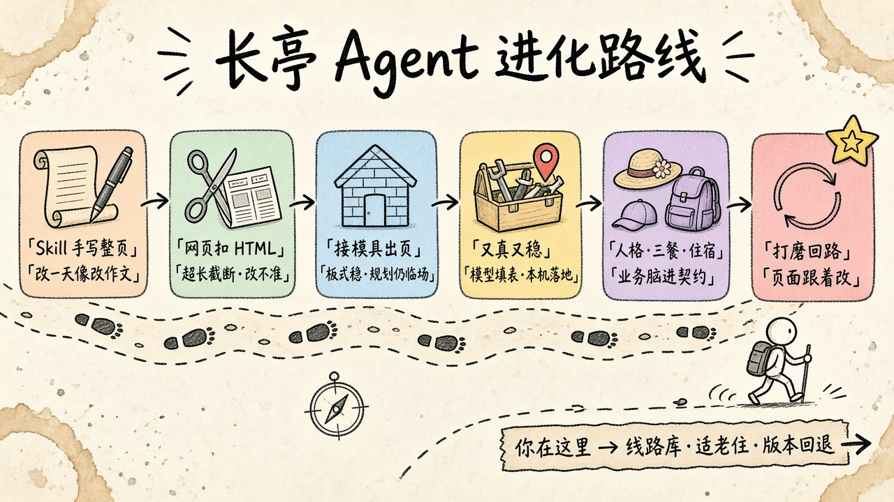

# Travel Monkey：改动沉淀与能力地图

本文整理 Travel Monkey（仓库目录 `travel-monkey-agent`）从「手写 HTML 攻略」走到「模具出页 + 本机工具」期间的改动，以及这些能力分别服务哪一类产品目标。评测尺子仍以 [EVAL.md](./EVAL.md) 为准；本文不另打分。

读法：先看进化路线，再看分层（Prompt / Skill / 脚本工具 / 第三方），再看四类价值。第 7 节是规划专家对本文和产品的评审。**个例店名、某一天的改法不写进通用 Prompt**，写进本机规则或线路库。

---

## 1. 从哪条路走过来

工程上已经走对了：从「改作文」变成「改表格」。规划条（累不累 / 雨砍 / 停车再走）已进每天；还没到能当带队/适老/徒步依据的线路库。

### 1.1 进化路线图（手绘风）

路是一条古道虚线，六站便签从左到右：手写整页 → 网页扣 HTML → 接模具出页 → 又真又稳 → 人格三餐住宿 → **打磨回路**；路尽头小哥路牌写的「你在这里 → 线路库·适老住·版本回退」在本轮已落第一版（线路库 v2、适老/连住/集合点、版本回退持久化，见 §8.1）。另附文字版附图（英文，避免编码问题）：[`travel-monkey-agent-timeline-companion.svg`](./travel-monkey-agent-timeline-companion.svg)。下一站旗子：**线路库打分入库 · 跨会话记忆 · 当日陪伴**。

### 1.2 时间线

| 大约时候 | 站 | 做法 | 学到什么 |
|---|---|---|---|
| 2026-09-01～05 | Skill 手写整页 | Cursor 里跑 `travel-plan-viz`：规划蜀道 6～7 日，改日期、加点、换图、上传公网 | 内容可以很满；改一天像改作文，token 贵、版式易乱 |
| 2026-09-05 | 定 6 格 | 「每天线路 1 + 景 3 + 住 1 + 餐 1」写进 Skill 契约 | 阅读结构必须先于美 |
| 2026-09-06 | 网页扣 HTML | 网页 Agent 从模型回复里抠 `<html>` | 超长截断、改不准、无法校验 |
| 2026-09-06～07 | 接模具出页 | `renderTrip` + `validateAll` + 种子 JSON；Skill 原文不每轮塞进提示 | 板式稳、可分享；规划仍靠临场 |
| 2026-09-08～12 | 又真又稳 | 契约蒸馏进 PLAN/FILL；高德/搜索本机调研；本地皮；先大纲后出页 | 模型填表，本机落地；密钥不能填网页地址 |
| 2026-09-14 | 人格·三餐·住宿 | 旅居/带队/探秘；强制 `dining` 早午晚；片区经济/中档/高端各一家 | 业务脑开始进契约，不只进渲染 |
| 2026-09-17 | 打磨回路 | 改表补丁、本地落表、一句多意图（改点+补图）；配图高德优先 | 用户不会一次规划完；页面必须跟着改 |
| 2026-09-22 | 规划条 | 日级 `craft`：累不累 / 雨砍 / 停车再走；本机缺则补，模具画在 6 格上方 | 没有这三句，页面只是观光日 |
| 现在之后 | 还没走到 | 线路库、适老/连住/集合点、行程版本 | 见第 5、7 节 |

一句话：**模型负责判断和填表，模具负责版式，本机工具负责真坐标/真交通/真图。** 不要让模型写 CSS，也不要把 skill 原文每轮塞进上下文。

---

## 2. 分层盘点

### 2.1 Prompt（通用契约，不是个例说明书）

位置：`server/skill-prompt.mjs`。四种模式，**互斥**，短、可校验。

| 模式 | 干什么 | 刻意不干什么 |
|---|---|---|
| PLAN | 短大纲：人格、每日 6 段、三餐店名、住宿片区三档、最多 3 条待确认（每条必须带「答案：A/B/C/D」） | 不写 JSON、不写 HTML |
| FILL | 只输出一份 `trip` JSON | 不编 photo URL、不写 `themeCss`、不重排已确认大纲 |
| TALK | 对照摘要回答好不好走、吃什么、远不远、累不累、下雨砍什么、车停哪 | 不假装已改、不讲配图流水线、不说「两条线」；追问必须带「答案：」行 |
| EDIT | 只输出补丁 JSON（`changes` / `replaceDays`） | 不吐完整 trip；新增≠改名；配图交给本机；必须问时 reply 带「答案：」行 |

原则：

- Prompt 只写**规则**（新增写进空格或午休/茶歇；三格都是实点则只问替换哪一格）。
- 不要写店名对照或某一天的改法；个例由本机 `applyAdds` / 名称匹配处理。
- Skill 原文（`SKILL.md`、`page-contract.md`）启动时只做状态展示，**不每轮注入**，省 token。

### 2.2 Skills

| Skill | 角色 | 和网页 Agent 的关系 |
|---|---|---|
| `travel-plan-viz` | Cursor 侧完整规划+出页流程；6 格契约、调研指南、校验 | 网页端蒸馏其契约，**不执行**其「每次用 frontend-design 重画 HTML」 |
| `changting-eval` | 复评步骤 | 尺子只在 EVAL.md；Skill 不另定标准 |
| 模具 `page-contract.md` | 每天 6 格、字段、禁手拼预订链 | 渲染与校验的硬约束 |
| `research-guide.md` | 调研清单；可选官方 MCP | 网页端用本机 HTTP 实现其中能落地的部分 |

模具和 Skill 是两层：Skill 管「怎么规划」，模具管「怎么出页」。第 4 步换皮只换本地主题包，校验失败回退陶土宣纸。

### 2.3 脚本与本机工具（真正省 token 的一层）

| 模块 | 作用 |
|---|---|
| `src/lib/trip.ts` | 行程摘要 `digestTrip`；意图：改表/同步/新增/配图/规划条；本地解析 1–6 点、改格、改餐、减负/雨砍/停车、新增点；`applyChanges` / `applyReplaceDays` / `applyAdds` |
| `src/lib/target.ts` | 点名某一天/某一格：Token 对上格子再改内容或补图，不写个案；括号里的通称当别名（「人头上（人头山）顶」认「人头山」） |
| `src/App.tsx` | PLAN→确认出页→FILL；改表与配图可同一句执行；问答只带最近摘要；每次成功出页留版，工具栏「回到上一版」 |
| `server/viz.mjs` | 补齐三餐、人格；住宿栏只用真店名+位置（调研三档优先），景点名不当片区、不造「经济参考」凑图；适老/连住/集合点按人格进 tips；`trip.budget` 预算信封 |
| `server/photos.mjs` | 配图管线：点评→高德→百度→维基；只换点名的格子；检索词景点名在前；换失败保留原图；名点图落盘缓存（`server/.cache-photo.json`，跨重启复用） |
| `server/research.mjs` | 规划前调研一次：地理编码、POI（含地址）、天气、三档酒店线索、公开搜索摘要；酒店不过滤省名（避免「甘肃」误杀甘南店）；线路库 v4 三层（L1 高德 POI 活数据／L2 8 条模式非实测标注／L3 2 条薄数据实测线带来源更新置信）进摘要供 FILL 强引用 |
| `server/transport.mjs` | 邻点步行/公交耗时；30km 以上城际走驾车（`intercity`）；按人格转公交阈值（旅居 20min/带队 30min/探秘 90min）；`actionLink` 只用官方 `uri.amap.com`（GCJ-02→WGS-84） |
| `server/craft.mjs` | 日级规划条：负荷 / 雨砍 / 停车再走；FILL 缺则按人格+点名补齐 |
| `server/themes.mjs` | 本地皮，换皮不走模型 |
| `server/chat-proxy.mjs` | 按模式挂系统提示（plan/fill/talk/edit/look）；密钥与服务商错配提示；带图这轮把图挂到最后一条用户消息上，上游嫌弃图片时翻成「换个认图的模型」 |
| `server/images.mjs` | 把本机图读成 base64 发给模型：只认 `travel-assets/` 下的文件（越界路径一律拦）、单图 5MB、一次最多 4 张；OpenAI 用 `image_url`，Anthropic 用 `image.source.base64`，外链原样透传 |
| `server/uploads.mjs` | 收粘贴/拖入的图：存成 `travel-assets/uploads/<内容hash>.<ext>`，只认 jpg/png/webp/gif/avif，单张 8MB，文件名由哈希定（不吃用户传的路径） |
| `src/lib/attach.ts` | 附件读取与分流：`wantsVision` 判这一轮是贴图（本机、不花钱）还是看图（送模型、烧 token） |
| 模具 `gen-shudao-html.js` + `validate` | 固定 6 格栅格、清单、地图 |
| 导出 | 单文件 H5、长图、系统分享 |

能本地落表（「请同步」且上文已有 1–6 点；「第 N 天第 M 格改成…」；「某天新增某点」）就**不打模型**。

### 2.4 第三方能力：现状不是 MCP，是本机 HTTP

网页 Agent **当前没有**把高德/小红书/百度/维基接成 Cursor MCP。它们是 Node 里直连的开放接口或公开页。Skill 文档里的「官方 MCP 优先」是 Cursor 侧增强项，网页端用同一套 `trip` 字段降级实现。

| 来源 | 网页端怎么用 | 有 Key？ | 不能做什么 |
|---|---|---|---|
| **高德 Web 服务** | 地理编码、POI、店图、天气、步行/公交、官方导航 URI | 可选 `ct.amap` | 不代叫车、不写死 deeplink |
| **Tavily / Serper** | 航班/酒店/时令公开页摘要；部分配图检索 | 可选 | 不代订、不保证实时价 |
| **百度图片** | 高德店名对不上时的第二层 | 无（公开页） | 易脏，必须店名/地点打分 |
| **维基 / Commons** | 百度对不上时的第三层，名点较稳 | 无 | 冷门点易配错；宁空 |
| **大众点评店页** | 有搜索 Key 时的第一层 | 需搜索 Key | 只取 `dianping.com/shop` 公开图；无官方点评接口；不爬商户后台 |
| **飞猪** | 契约写「不能代订、不手拼预订链」 | 未接官方预订 | 没有 MCP/开放下单就不装可订 |
| **OSM / Leaflet** | 行程地图底图 | 无 | 坐标必须 WGS-84 |
| Cursor 里 Notion / Figma 等 MCP | 开发工作流 | 与旅行产品无关 | 不要当成行程数据源 |

若以后要「更像官方旅行 Agent」，优先接 **高德官方 MCP**（坐标、路况、天气、导航），其次才是飞猪类预订 MCP。点评/图搜没有稳定官方 MCP 时，维持「店名对上才用图」，不要做爬虫。

---

## 3. 四类价值（同一能力可以进多类）

### 3.1 提升旅行类应用体验

用户感知：页好看、数靠谱、能带走、改完立刻看见。

| 能力 | 为何有效 | 状态 |
|---|---|---|
| 6 格模具 + 手机一列 / 桌面两列 | 每天结构可预期，老人也读得完 | 已固化进契约 |
| 先大纲后出页 + 待确认点选 | 避免一上来填一张错表 | 已做；问答统一「答案：A/B + 按你建议/先跳过 + 自己写」 |
| 人格芯片（旅居/带队/探秘） | 同一骨架三种节奏 | 契约已落地；适老入住未做 |
| 强制三餐 + 住宿三档 | 吃住不再附属在第 6 格 | 结构已有；店名仍参考 |
| 高德交通 + 官方导航 | 「好不好走」变成分钟数和可点开的图 | 有 Key 时可用 |
| 配图：点评（有搜索 Key）→ 高德 → 百度 → 维基；对不上留空 | 空图好过配错地方 | 已做；无官方点评接口 |
| 线路格按到达地取景；午休/茶歇按所在点取景 | 避免「每日线路空白」「两格同一张图」 | 已做 |
| 本地换皮 + 校验回退陶土 | 设计感不靠模型改 CSS | 已做 |
| H5 / 长图 / 分享 | 规划的终点是带出门 | 已做 |
| 密钥错配前置提示 | 认证失败要说清是哪家网关 | 已做 |

高杠杆未做：无 Key 时的诚实降级文案给老人看；住宿适老/连住/集合点；按人格选交通方式。

### 3.2 提升识别和理解用户意图

用户感知：我说的几件事都会做，不会只配图、不改点。

| 能力 | 解决什么误判 | 状态 |
|---|---|---|
| PLAN / FILL / TALK / EDIT 分模式 | 提问当成改表、改表当成出整页 | 已做 |
| `resolveTargets`：按天号 + 点名 Token 对格 | 「改某一格 / 补某一格的图」对不上或改错天 | 已做；不问个案店名 |
| 一句多意图：先改表再配图 | 「某天新增某点 + 要图」只走配图 | 已做 |
| `inferAddsFromText` + 不覆盖已有点名 | 「新增」被当成把已有点改名 | 已做 |
| 组合店名切分（顿号/加号） | 只配前半段、后半段点名对不上 | 已做 |
| 抱怨/继续优化时回放上一句用户请求 | 「为啥没反应」空谈或乱打补丁 | 已做 |
| 人格检测（退休→旅居，导游→带队） | 看不出则待确认第 1 条只问人格 | 已做 |
| TALK 禁止「两条线、同步不了」 | 模型把产品缺陷说成设计 | 已做 |

边界：意图仍主要靠中文正则和结构解析。复杂口语（「那天别走那么满，砍一段接附近歇脚」）在有完整 1–6 列表或明确格号时本机能吃；否则仍走一轮短 EDIT。不要为了个案把店名写进系统提示。

### 3.3 改善对话持续性（上下文不断档、页跟着话走）

用户感知：打磨某一天不必重规划；问距离不必重出页。

| 能力 | 机制 | 状态 |
|---|---|---|
| `trip` JSON 为唯一事实源 | 改格子不改报纸 | 已做 |
| 每轮只传 `digestTrip`（可按天裁） | 不传整表、不传 HTML | 已做 |
| 问答回看短（约 4 条），丢掉「已写入页面」回执 | 持续对话不膨胀 | 已做 |
| 调研只做一次，改天不重跑 | 上下文稳定、花费可控 | 已做 |
| 本地落表：能解析就不打模型 | 「请同步」0 token | 已做 |
| 改名后本机补图补交通 | 用户不必再下「请配图」指令 | 已做 |
| 确认出页后 FILL 严格按大纲 | 防止模型聊着聊着重排线 | 已做 |

未做、但对持续性很重要：行程版本历史（可回退到「改某一格之前」）；跨会话记住人格与常用片区（现只在当页 `localStorage` 存密钥，不存行程）。

### 3.4 长期价值沉淀

能跨用户、跨行程复用的资产，而不是某一句 Prompt。

| 资产 | 沉淀物 | 优先级 |
|---|---|---|
| **6 格页面契约** | 所有行程同一阅读结构 | 已有；勿为个案拆格 |
| **EVAL 尺子** | 标准化/专业性/实用/稳定/体验；路径/景点/三餐/住宿 | 已有；复评改快照 |
| **人格规则** | 旅居少走、带队必看可砍、探秘难度补给 | 契约已有；缺线路库打分 |
| **种子行程 JSON** | 一条可渲染样例，证明模具 | 有；应升为「线路库」第一条 |
| **配图缓存与白名单 host** | 名点图可复用；错图规则可复用 | 进程内 cache；可落盘 |
| **POI 真名 + WGS-84** | 高德回来的点可进知识库 | 仅当次调研；未入库 |
| **dataSources / 免责声明** | 实时 vs 参考分得清，构成信任 | 字段已有 |
| **本机工具代替爬虫** | 高德/维基/公开检索可维护 | 已有；不要加商户后台爬取 |
| 用户侧长期记忆 | 人格偏好、忌口、常住档位 | **未做** |
| 经典线路库 | 按线收录必看/可砍/耗时/补给，FILL 时引用 | **未做（专业性主缺口）** |

继续加皮或加爬虫，边际收益低。长期该沉淀的是：**线路知识、入住规则、配图/坐标缓存、会话版本**。

---

## 4. 对照四类价值的总表

| 能力 | 体验 | 意图 | 持续 | 沉淀 |
|---|---|---|---|---|
| PLAN/FILL/TALK/EDIT 短提示 | ✓ | ✓ | ✓ | 契约 |
| 6 格模具 + 校验回退 | ✓ |  | ✓ | ✓ |
| 人格 + 三餐 + 酒店三档 | ✓ | ✓ |  | ✓ |
| digest + 短回看 + 调研一次 |  |  | ✓ | 省 token |
| 本地补丁 / 新增 / 同步 | ✓ | ✓ | ✓ |  |
| 一句改表+配图 | ✓ | ✓ | ✓ |  |
| 高德坐标/交通/店图 | ✓ |  |  | 可入库 |
| 百度/维基/大众点评图 | ✓ |  |  | 弱（易变）；宁空 |
| 飞猪代订 | — | — | — | 无官方接口则不做 |
| 官方高德/飞猪 MCP | ✓（更真） |  |  | 责任在对方 |
| EVAL + changting-eval |  |  |  | ✓ |
| 线路知识库 / 适老入住 | ✓ | ✓ |  | ✓ 主缺口 |
| 日负荷 / 雨备 / 停车再走 | ✓ | ✓ |  | ✓ 已落地 `day.craft` |

---

## 5. 可以接着做、且对得上四类目标的下一刀

来自 EVAL 仍成立的 P0，以及打磨回路里已经暴露、但还未变成资产的部分：

1. **住宿一等公民**：片区对齐当日 stay；旅居要电梯/一层/坐便；带队要集合点/停车；探秘要走完再住。这是体验 + 沉淀。
2. **线路库**：把现有种子行程升级为可检索的「必看/可砍/耗时/补给」条目，FILL 时优先引用。这是专业性 + 意图（用户点名某段线时对得上）。
3. **行程版本**：每次成功 `apply*` 留一版 digest，支持「回到上一版」。这是对话持续。
4. **配图/POI 落盘缓存**：按「规范化店名 + 目的地」存 URL 与坐标，跨行程复用。这是体验 + 沉淀。
5. **高德 MCP（可选）**：仅当要实时路况/多方案交通时再接；网页 HTTP 已覆盖地理编码与邻点。不要为「接 MCP」而接。
6. **Prompt 纪律**：通用契约保持短；新规则进 `trip.ts` / photos，不进 `EDIT_SYSTEM` 个例。
7. **规划专家层（第一刀已落地）**：`day.craft` 回答累不累、下雨砍什么、车停哪再走。还缺的是闭馆/演出时刻、多人汇合、总预算、风险退出、当日陪伴。

---

## 6. 文件索引

| 文档/代码 | 用途 |
|---|---|
| `docs/EVAL.md` | 怎么打分、当前快照 |
| `docs/CAPABILITY.md` | 本文：改动与能力地图 |
| `docs/MEMORY.md` | 上下文、记忆、多轮会话的评测标准、快照与待办（M1～M8） |
| `.cursor/skills/changting-eval/SKILL.md` | 复评步骤 |
| `server/skill-prompt.mjs` | 四模式 Prompt |
| `src/lib/trip.ts` | 意图与本地落表 |
| `server/craft.mjs` | 日负荷 / 雨砍 / 停车再走 |
| `server/photos.mjs` / `research.mjs` / `transport.mjs` | 图、调研、路 |
| `docs/travel-monkey-agent-timeline.png` | 第 1 节手绘风进化路线图 |
| `vendor/mold/` | travel-plan-viz 完整副本：出页、校验、坐标、契约、调研/美学说明、样例、种子 JSON、单测。不再读仓库外的 travel-plan-viz-main |
| `travel-assets/` | 种子配图；用户上传在 `uploads/`（不进版本库） |

---

## 7. 规划专家评审：本文与产品还差什么

评审立场：资深线路规划（带过退休团、导游备课、徒步向导三种活），不是前端评审。对照「专业、超高体验的旅行 Agent」，不是对照「能演示的网页」。

### 7.1 这份文档本身

| 判断 | 说明 |
|---|---|
| **合理** | 分层对（Prompt / Skill / 本机工具 / 第三方）；四类价值能用来排优先级；第三方边界诚实（高德是 HTTP 不是 MCP；不代订） |
| **作为工程地图够用** | 开发者能知道「不要抠 HTML、不要个例进 Prompt、能本地落表就不打模型」 |
| **作为专业产品说明书不够** | 缺「什么样的一天算合格」；缺三类人的质量条；第 5 节几乎全是工程债，规划债只点了住宿和线路库 |

建议：本文继续当能力地图，不要写成 EVAL 第二份打分表。规划质量条补在本节，分数仍只改 EVAL。

### 7.2 已经像专业产品的部分

- **先大纲后出页**：真规划也是先定骨架再填点，不会一上来排版。
- **6 格阅读结构**：带队讲解和老人阅读都吃得下；一天三景封顶对旅居是对的。
- **宁空不配错图**：错图会直接毁掉信任，比空白更伤。
- **不装可订**：没有官方下单却放「去预订」是业余。
- **实时与参考分开**：高德路、搜索价，分得清才像顾问。
- **打磨回路**：真用户一定会改某一天；页不跟着改，前面全白做。

### 7.3 要「超高体验」还缺的规划能力

第一刀（累不累 / 下雨砍什么 / 车停哪再走）已进 `day.craft`，画在 6 格上方。对专业 Agent 下面其余项仍不是锦上添花。

| 缺口 | 旅居 / 带队 / 探秘分别要什么 | 文档/产品现状 |
|---|---|---|
| **日负荷** | 旅居：步行公里与爬升封顶；带队：集合后总时长；探秘：海拔、补给点、撤退点 | **已落地** `craft.load`（轻/中/偏累 + 走路量 + 原因）；公里/爬升/海拔仍是下一刀 |
| **天气与拥挤开关** | 节假日/周末换室内或错峰；暴雨砍露天徒步；暑热把户外提前 | 调研有一次天气摘要，不会改排程 |
| **闭馆 / 演出时刻** | 闭馆日、夜场演出二选一 | slot 有字段，FILL 不强制核验 |
| **多人汇合** | 不同出发地分头抵达，某时前赶到起点 | 当普通航班文案，没有汇合节点 |
| **后勤链** | 停车→接驳→徒步→取车→住；探秘缺一环就不能出队 | **已落地** `craft.park`（停哪 / 再走 / 取车）；接驳时刻与官方停车场名仍靠模型或调研 |
| **必看 / 可砍 / 雨备** | 带队备课三列；旅居「可砍」是少走路；探秘「不值得就不走」 | **已落地** `craft.rain` + 景点 `cuttable`；必看仍写在 review |
| **预算信封** | 三档酒店没有总预算，无法满足「中档走完」 | 有档位无合计 |
| **风险与退出** | 旅居：医疗半径与少台阶逃生；带队：失散与恶劣天气收队；探秘：撤退点、补给断、湿滑停走 | 没有结构化字段 |
| **出发当日陪伴** | 「现在该出发了吗、今天会不会下雨」 | H5 是静态纪念册，不是当日向导 |
| **版本与回退** | 「改某一格之前」必须能回去 | 文档已写未做 |

没有线路库，模型每次临场「推荐经典」，带队看来就是学员作业。种子行程只证明模具能画，不能证明系统会规划。

### 7.4 体验层：顾问感还差一截

- 左侧仍是开发者工作台（多 Key、服务商）。目标用户不应配置模型/高德/搜索。
- 对话仍偏「填表助手」：报主题名、报补丁失败、报配图流水线，都不是顾问口吻。
- 一张图错、一条路没分钟数，用户会怀疑整页。体验瓶颈在**内容稳**，不在换皮。

### 7.5 意图与持续：工程补丁有效，还不是理解

- 正则能吃「新增 / 同步 / 第 N 格」，吃不透「那天别走那么满，砍一段接附近歇脚」除非用户列出 1–6。
- 多意图拆开做对，但是「优化一下」没有规划语义（减负？换景？换住？）。
- 跨会话不记得人格、忌口、适老入住。专业顾问第二次见面是记得的。

### 7.6 结论与补充原则

| 问 | 答 |
|---|---|
| 文档方向对不对？ | 对。工程叙事完整，第三方没吹过头。 |
| 够不够打造专业超高体验 Agent？ | 不够。差的是**规划质量条**和**可复用线路知识**，不是再接一家图源。 |
| 进化图停在哪？ | 「规划条」已上路。下一站仍是旗子上的线路库 / 适老住 / 版本回退。 |

补充原则（可直接当产品纪律）：

1. **一天要能回答四句**：走哪条、看什么、吃什么、住哪里——现契约已覆盖结构。
2. **还要能回答第五句**：今天累不累、下雨怎么办、谁可以砍。这句现由 `day.craft` 回答；没有它，就不是专业规划。
3. **知识进库，个例不进 Prompt。**
4. **模具保持 6 格**；负荷、雨备、后勤写进 `review` / `tips` / 独立字段，不要再拆第七格。
5. **先让名点稳、主路径算得清**，再谈 MCP 和预订。

---

## 8. 专家复评（2026-09-30）：是否合理、是否完善，还差什么

评审口径：旅行规划行业需求 × 用户体验 × 业界 Agent 三性（易用/专业/稳定）。结论先行：

| 问 | 答 |
|---|---|
| 当前应用合理吗？ | 合理。模型填表＋模具出页＋本机求真，三权分立是对的；6 格、digest、调研一次、宁空不配错，都是省 token 又保体验的正确 trade-off |
| 完善吗？ | 不完善。EVAL 五维里**标准化 7.5→8 相差一口气**，**专业性/体验是主缺口**：住宿只有店名清单、没有预算信封；能改某格但不能回退；线路靠临场没有库；跨会话不记人 |
| 能打专业超高体验吗？ | 还不能。差的三件都是规划资产（住宿规则、线路库、记忆/版本），不是再接一家图源或再换一套皮 |

### 8.1 本轮 TODO（已按单逐个落地，细节见时间线 SVG）

| # | 功能项 | 落点 | 状态 |
|---|---|---|---|
| 1 | 住宿一等公民：片区对齐 stay；旅居电梯/一层/坐便、带队集合点/停车、探秘走完再住，按人格进 tips；**连续**同片区连住注记（跳镇不误标） | `server/viz.mjs`（`stayFitTip`/`markStayNights`） | ✓ 已做＋已打磨 |
| 2 | 预算信封：整程晚数×三档中间价，`trip.budget`，**模具住宿栏末尾渲染可见**，FILL 不用填 | `server/viz.mjs`（`ensureBudget`）＋模具 `renderHotels` | ✓ 已做＋已打磨 |
| 3 | 行程版本：每次成功出页留版（近 10 版，随会话存 IndexedDB），工具栏**版本下拉＋回退** | `src/App.tsx`（`versions`/`versionSel`） | ✓ 已做＋已打磨 |
| 12 | 会话与约束板（MEMORY M1～M3）：会话存 IndexedDB，刷新接着上次，左栏可新建 / 切换 / 删除行程；本趟硬约束（同行、身体、忌口、日期、天数、出发地、交通、住宿、预算）本机抽取＋改表回复带 `facts`，每轮注入所有模式，左栏可看可删 | `src/lib/session.ts`（新）＋`src/lib/memory.ts`（新）＋`src/lib/trip.ts`（`extractEnvelope` 透出 `facts`）＋`server/skill-prompt.mjs`（`EDIT_SYSTEM`）＋`src/App.tsx`／`styles.css` | ✓ golden 96/96；浏览器实测刷新恢复 |
| 13 | 短期记忆补齐（MEMORY M4／M5＋3c）：出大纲 / 填表带用户原话（600 字）；约束板加必去 / 不去，出大纲、出页后本机查撞否决自动打回；认改口撤约束；附件和点选答复也抽；PLAN / TALK 末尾「记下：」行本机解析；窗口外本机滚动摘要（300 字）；拼消息抽成纯函数做多轮回归 | `src/lib/context.ts`（新）＋`src/lib/memory.ts`＋`server/skill-prompt.mjs`（`MEMO_RULE`）＋`src/App.tsx` | ✓ golden 121/121；浏览器实测否决打回、改口撤销 |
| 4 | 线路库 v2：蜀道/甘南/京都/**深圳大鹏/西安城墙**（必看·可砍·耗时·补给），进调研摘要供 FILL 引用（必看不漏、可砍二选一） | `server/routes.json`＋`research.mjs`＋FILL 一句 | ✓ 已做＋已打磨 |
| 4＋ | 加分轮：线路库 v3（20 条＋代表性/性价比/难度打分），FILL 强引用（代表性≥4 星必看不漏）；`npm run golden` 18 项覆盖 | 同上＋`scripts/golden-test.mjs` | ✓ golden 18/18 |
| 4＋＋ | 三层重构 v4：L1 高德 POI 用深（地址进摘要，活数据不手写）；L2 模式库 8 条（高原草原/古城步行/海岛亲子/名山徒步/湖环线/石窟人文/都市观光/水乡夜游，地形＋主题命中，**非实测标注**）；L3 只留 2 条薄数据高风险实测线（蜀道抄手铺段/甘南夏河线，来源/更新/置信备查）；防呆 `arr()`（脏数据只降级不断 brief）；`npm run golden` 21 项覆盖 | 同上＋`server/routes.json` v4＋`routeLibraryLine` 导出可测 | ✓ golden 21/21 |
| 5 | 配图/POI 落盘缓存：名点图跨重启复用（单 `fs` import，写盘路径已验证） | `server/photos.mjs`（`server/.cache-photo.json`） | ✓ 已做＋已打磨 |
| 6 | 下一站（未做）：线路库打分入库、跨会话记住人格/忌口/档位、出发当日陪伴、闭馆/演出时刻核验 | — | ○ 待排 |
| 10 | 输入框收图片/附件：粘贴（⌘V）和拖拽两种方式（不放按钮，少一个常年没人点的控件）；zip 直接拖进来本机拆包——里面的文本读成资料、图片照常落 `uploads/`，不引第三方库（自己读中央目录＋浏览器内置 `DecompressionStream`），zip64／加密／异常包明确报错不假装收下；图片存到 `travel-assets/uploads/<内容hash>.<ext>`（同图重复粘不堆文件），直接贴进你点名的那一格（认「D2第2格」、认点名、认括号里的别名如「人头上（人头山）顶」→「人头山」），说不清就按本机问法列 A/B/C 候选；**用户贴的图只有点名那一格才让换**，按天/按种类的批量补图一律绕开；文本附件（txt/md/json/csv）读成资料拼进给模型的话里。贴图不走模型、不耗 Key | `server/uploads.mjs`（新）＋`vite.config.ts`／`server/prod.mjs` 路由＋`src/lib/attach.ts`（新）＋`src/lib/trip.ts`（`applyPhotoTo`）＋`src/lib/target.ts`（括号别名）＋`server/photos.mjs`（本地图保护）＋`src/App.tsx`／`styles.css`（chips/拖拽） | ✓ golden 57/57 |
| 11 | 模型看图（视觉）：同一张图，说「D2第2格用这张」就贴进页面（本机、不花钱），说「这是哪／图里写的什么／根据这张图规划」就送模型看（`look` 模式）。本机图读成 base64 内联（上游取不到 127.0.0.1），OpenAI 系用 `image_url`、Anthropic 用 `image.source.base64`。看图这轮只出文字、不动页面。提示词强制分清「看得见的」和「推测的」并写明把握，认不出就说认不出、不许硬凑景点名。选了不认图的型号（如 deepseek）直接拦下并点名可换的模型，不白烧一轮 | `server/images.mjs`（新）＋`server/chat-proxy.mjs`＋`server/skill-prompt.mjs`（`LOOK_SYSTEM`）＋`src/lib/attach.ts`（`wantsVision`）＋`src/lib/chat.ts`＋`src/App.tsx`（`runLook`） | ✓ golden 67/67；mock 上游验过两家报文形状 |
| 9 | 改表不挑模型脾气（补丁健壮性专轮）：根因是**只认一种补丁形状**——模型把值平铺成 `{day,slot,name}`（不套 `set`）就被判「没有 set」全丢；更常见的是模型只回一句「我已经把…换成…了」不给补丁，本机照实什么都不改，用户看到"模型答了、页面没动"。现在：平铺补丁（含餐、规划条）照收；模型只口头声称改好、或反问、或回纯文本时，用**本机按你原话兜底改**；一个补丁都没落地时**不转述模型那句「已改好」**，只说「这次没有改到页面上」并给出可用句式 | `src/lib/trip.ts`（`liftSet`/`inferEditFrom`/`stripEditClaim`/`findSlot` 反向包含）＋`src/App.tsx`（`runEdit` 兜底、`commitEdit` 不转述假话） | ✓ golden 49/49 |
| 8 | 改天/换图必见（意图路由专轮）：根因是**配图请求被路由进改表分支**——`wantsPhotos` 不认「图片/照片」，于是「优化day1、day2的景点图片」被当成改表交给模型，而 EDIT 契约明写「问图不要改表」，模型回空补丁 → 页面不动；「图片不对，请更换」更是掉进纯聊天。同轮补齐：多天点名（`mentionedDays`，「第5格」不再误判成第5天）、天范围隔离（只动点名的天，别人的图不冲）、用户显式检索词（引号里的词直接拿去搜）、泛名兜底（「一方小院」带当天地名再搜）、逐格收据（换上/搜不到分别报）；`npm run golden` 41 项覆盖 | `src/lib/trip.ts`（`wantsPhotos`/`wantsTripEdit`/`collectPhotoRequest`/`explicitPhotoQuery`/`photoOutcome`）＋`src/lib/target.ts`（`mentionedDays`/spot-only）＋`server/photos.mjs`（`photoDays`/`photoQuery`/泛名兜底）＋`server/viz.mjs`＋`src/lib/render.ts`＋`src/App.tsx` | ✓ golden 41/41 |
| 7 | 改天必见（bugfix 专轮）：overview 每次从 days 全量重建（根因：只建不刷，顶部卡片永远旧名）；收据验货（新名不在 HTML 里就降级为失败，不说"已写入"假话）；本地 kind 句式（D1住宿改成X 不走模型）；换图前后 URL 对比（没换成不说已补）；`npm run golden` 27 项覆盖 | `server/viz.mjs`（`normalizeTrip`）＋`src/lib/trip.ts`（`touched`/`findUnseenInHtml`/`collectPhotos`/`kindM`）＋`src/App.tsx`（`commitEdit`/`runPhotos`） | ✓ golden 27/27 |

### 8.2 过去改动归因：四类价值分别沉淀了什么

**A. 提升识别和理解用户意图**

| 改动 | 为什么算意图能力 |
|---|---|
| PLAN/FILL/TALK/EDIT 四模式互斥＋短提示 | 提问/改表/出页不再串台 |
| `resolveTargets` 天号＋点名 Token 对格 | 「改某一格/补某一格图」通用化，不写个案 |
| 一句多意图（先改表再配图） | 「新增某点＋要图」一次做完 |
| `inferAddsFromText` 新增≠改名、组合店名切分 | 新增不再吃掉已有点 |
| 抱怨回放（「为啥没反应」带上文再试） | 空谈/乱补丁减少 |
| 人格检测＋待确认第 1 条问人格 | 看不出人格时不硬猜 |
| 问答契约「答案：A/B＋按你建议/先跳过＋自己写」 | 选项即意图，点选代替复述 |

**B. 改善上下文对话持续性**

| 改动 | 为什么算持续性能力 |
|---|---|
| `trip` JSON 为唯一事实源 | 改格子不改报纸 |
| 每轮只传 `digestTrip`（可按天裁）＋问答回看约 4 条 | 上下文不膨胀 |
| 调研只做一次，改天不重跑 | 花费可控、结论稳定 |
| 本地落表（请同步/第 N 格/新增）0 token | 小改不打模型 |
| 改名后本机补图补交通 | 不必再下「请配图」指令 |
| FILL 严格按已确认大纲 | 模型聊着聊着不重排线 |
| **本轮：行程版本＋回到上一版** | 「改某一格之前」可回去，对话敢改 |

**C. 提升旅行类应用体验**

| 改动 | 用户感知 |
|---|---|
| 6 格模具＋手机一列/桌面两列＋校验回退陶土 | 每天结构可预期，老人读得完 |
| 先大纲后出页＋待确认点选 | 不一次填张错表 |
| 强制三餐 dining＋住宿三档真店 | 吃住不再是第 6 格附属 |
| 高德交通＋官方导航 URI | 好不好走变成分钟数 |
| 配图 waterfall＋宁空不配错＋只换点名格＋失败保原图 | 空图好过错图；不错杀别格 |
| 线路格按到达地取景；午休/茶歇按所在点取景 | 不再两格同一张图 |
| 本地换皮＋H5/长图/分享＋密钥错配前置提示 | 带出门；报错说得清 |
| **本轮：适老/集合点 tips＋预算信封＋线路库耗时补给** | 住得对＋花得清＋走得明 |

**D. 长期价值沉淀（跨用户跨行程复用）**

| 资产 | 形态 | 状态 |
|---|---|---|
| 6 格页面契约 | 模具＋校验 | ✓ 勿为个案拆格 |
| EVAL 尺子＋复评 Skill | `docs/EVAL.md` | ✓ 本轮已补 09-30 快照 |
| 人格规则 | 契约＋craft＋stayFit | ✓ 缺线路打分 |
| 种子行程→线路库 v4 三层 | `server/routes.json`（L1 POI 活数据／L2 8 模式／L3 2 实测线） | ✓ 本轮三层重构，golden 21/21 |
| 配图缓存＋白名单 host | 内存→落盘 `.cache-photo.json` | ✓ 本轮落盘 |
| POI 真名＋WGS-84 | 仅当次调研 | △ 下一步入库 |
| dataSources/免责声明 | 字段 | ✓ 实时 vs 参考分清 |
| 用户长期记忆（人格/忌口/档位） | 未做 | ○ 下一站 |
| 出发当日陪伴 | 未做 | ○ 下一站 |

判据：能进库（线路/规则/缓存/版本）的是资产；只解决某一天某家店的是个案，修完即止，不进 Prompt。
